# raceGPS: Cleveland cinematic intro + garage sign concepts

> **Status: concept mockups and drafts.** The intro video has **not been produced yet**. Everything here is early design work: written scene prompts, mockup stills and short sign-flicker loops.

**raceGPS** is real-world racing on real streets: GPS and street-map routes through your own city, with a late-night, neon, Midnight Club-style feel. Every city gets its own cinematic intro, and every city gets its own 24-hour garage.

Cleveland is first.

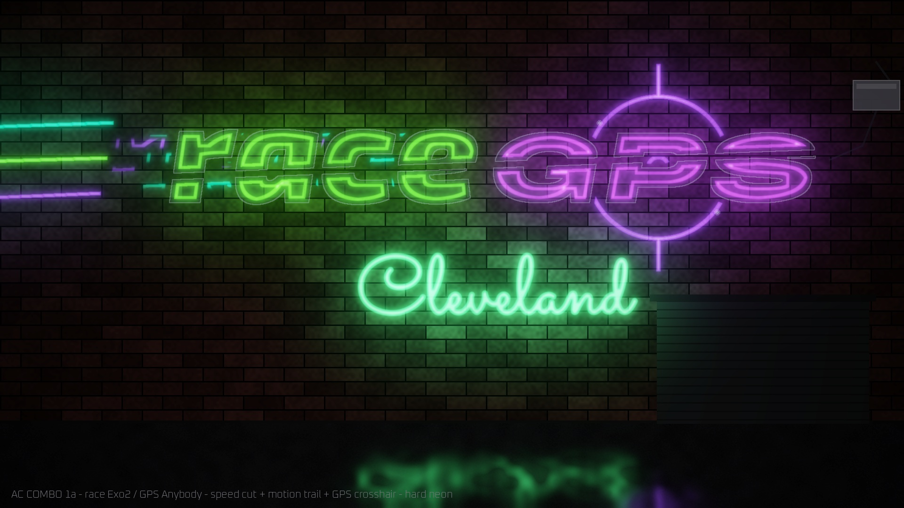
*Chosen sign direction (mockup): "race" in green neon with a speed cut and motion trails, "GPS" in purple with a neon GPS crosshair, "Cleveland" in flickering neon script below. [Flicker loop (mp4)](art/garage-signs/garage-AC-1-race-Exo2_GPS-Anybody-HARD.mp4)*

---

## The Cleveland intro (planned: 5 scenes × 10 s, ~50 s)

A realistic 2 a.m. night run along the real route out of downtown Cleveland, with a game-art layer of light streaks, speed lines and glitch wipes in raceGPS red plus purple, green and blue cyber neon. A word callout lands at every 10-second mark.

| # | Time | Scene | Callout |
|---|---|---|---|
| 1 | 0:00–0:10 | I-77 north into downtown, skyline ahead, onto the I-90 Innerbelt, diving under the Euclid and Superior overpasses | **INNERBELT** |
| 2 | 0:10–0:20 | Under the rusted steel rail bridge with its green-and-yellow 35 mph curve signs, then the ~86° right-hand bend (~870 ft) under the pillared concrete ramp overpass, bathed in amber light with flashing arrow boards | **DEAD MAN'S CURVE** |
| 3 | 0:20–0:30 | Out onto the Memorial Shoreway: Burke Lakefront Airport and Lake Erie on the left, Route 2 merging from the right as the road widens to five lanes, police lights tiny in the mirrors | **ROUTE 2 EAST** |
| 4 | 0:30–0:40 | Past the East 55th gantry the racers dust the police, sirens fading; the skyline glows behind under a black sky and a big full moon, and the frame settles into the logo plate | **LOSE THE HEAT** → **raceGPS** |
| 5 | 0:40–0:50 | Outro: the two cars parked on the lakefront under the moon, skyline across the water; glowing panels for credits, announcements and links | credits + links |

- Draft scene prompts: [`prompts/`](prompts/) (Scenes 1–5), with the edit plan in [`POST-EDIT-OVERLAYS.md`](prompts/POST-EDIT-OVERLAYS.md) and the production plan in [`FLOW-PLAN.md`](prompts/FLOW-PLAN.md).
- All words and the logo are added in the edit (DaVinci Resolve); the generated footage only carries empty glowing panels, because video models garble lettering.
- Police are only ever seen in mirrors or wide side views, never close, no contact.

### Built on the real road
Dead Man's Curve is real: I-90's ~86° bend where the Innerbelt meets the Shoreway, next to Burke Lakefront Airport. The scene geometry comes from OpenStreetMap data and public drive videos. See [`research/NOTES.md`](research/NOTES.md) and [`research/SOURCES.md`](research/SOURCES.md).

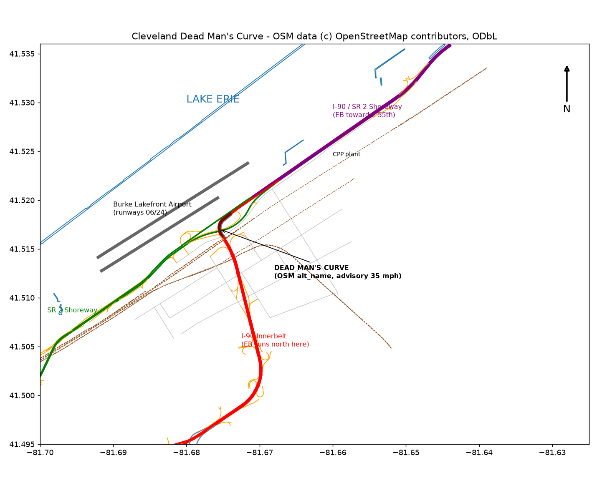
*Dead Man's Curve geometry from OpenStreetMap. © OpenStreetMap contributors (ODbL).*

Watch the real route (YouTube, links only):
- [I-77 N → I-90 E → the curve → Shoreway, daytime (Salamah), from 5:16](https://www.youtube.com/watch?v=hgHlRSynhn4&t=316s)
- [Dead Man's Curve eastbound in 4K (Mileage Mike Travels), from 0:50](https://www.youtube.com/watch?v=5avs-R55Wfo&t=50s)
- [Innerbelt eastbound at night (roadwaywiz), from 3:44](https://www.youtube.com/watch?v=F26h6MLTwzE&t=224s)
- [Downtown Cleveland night drive (Cool-E Road Trips), from 3:50](https://www.youtube.com/watch?v=CC6u-QHA9qg&t=230s)

---

## The 24-hour garage: one sign template, every city

The intro ends at a lit sign on a 24-hour garage named raceGPS. It's designed as a **template**:

- **raceGPS** always on top, never changes.
- The **city name in flickering neon script** below: "Cleveland" now, Akron and others later.
- Real glass neon, not LED strip: visible tube bends, electrode caps, painted-out gaps, a steady hum with the occasional real-neon stutter.
- Neon green and purple, in a punchy "hard neon" palette and a softer neon-pastel palette.
- Each city gets its own building and garage design around the same sign rules.

Full rules: [`art/SIGN-TEMPLATE.md`](art/SIGN-TEMPLATE.md)

| Hard neon | Neon pastel |
|---|---|
|  | 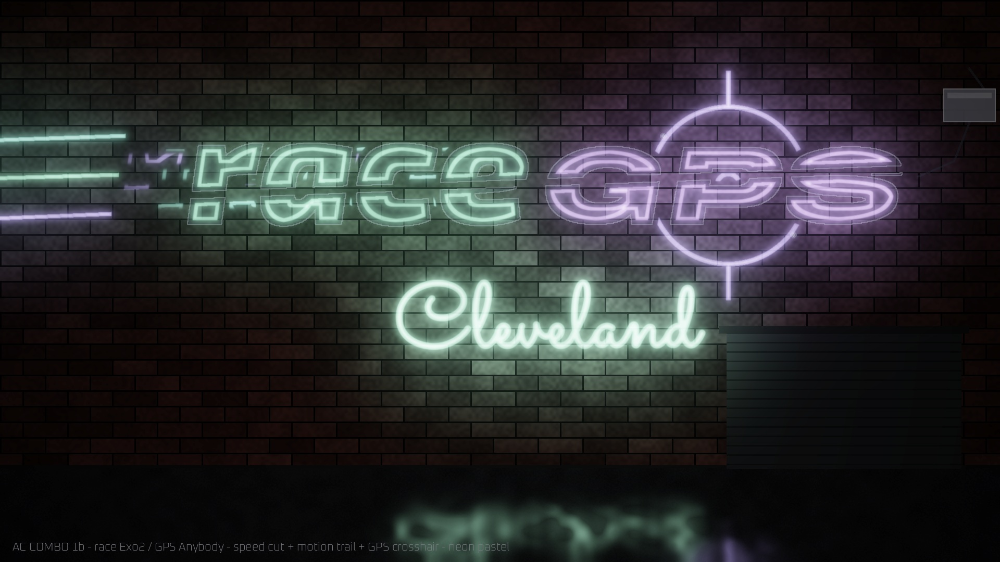 |
| 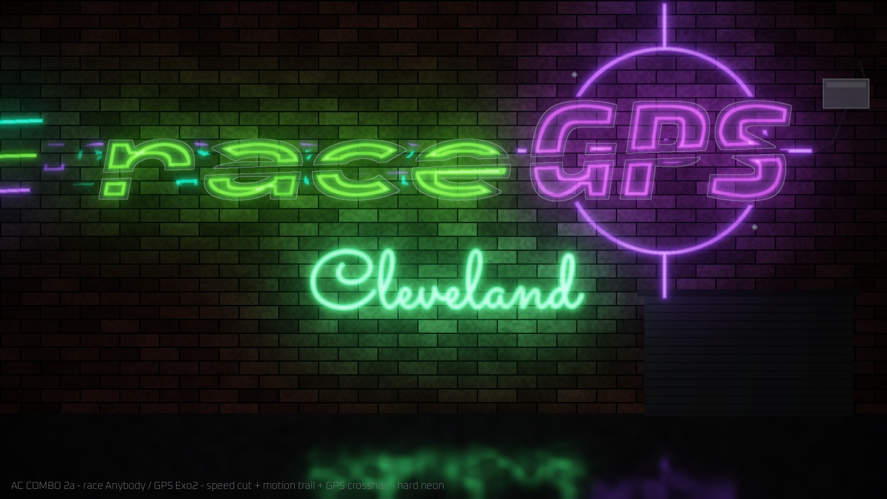 | 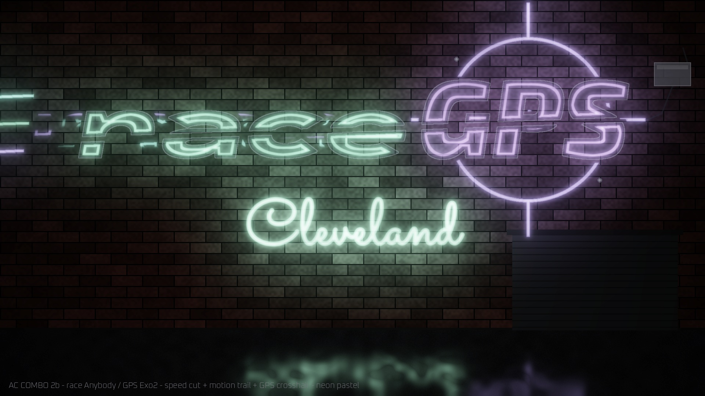 |

Earlier direction studies (before the city line was added):

| | |
|---|---|
| 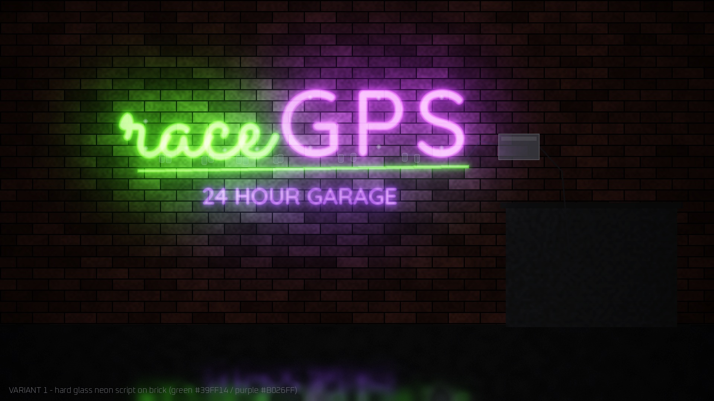 | 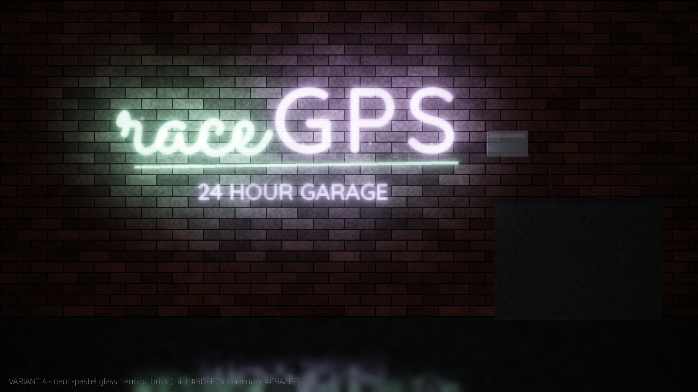 |
| 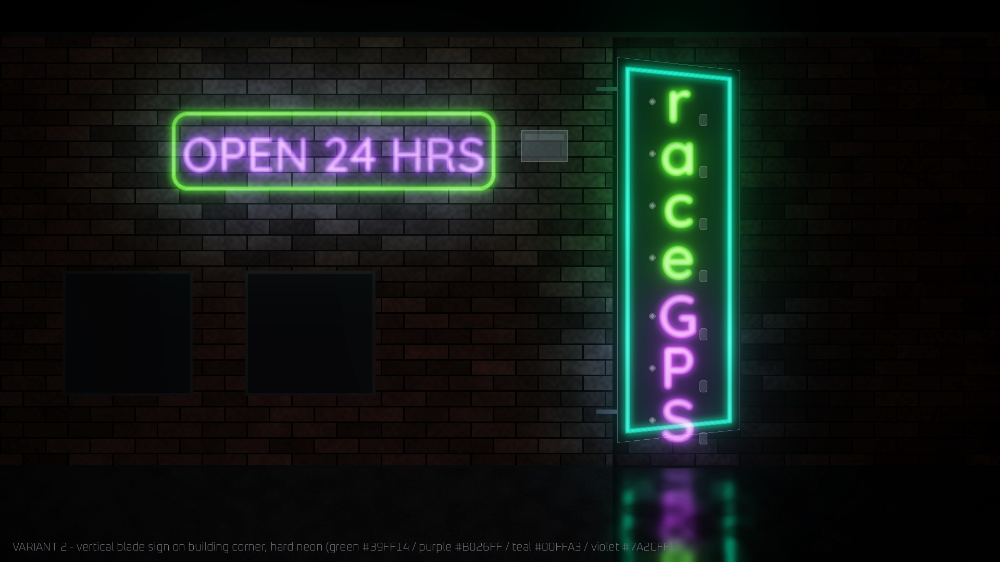 | 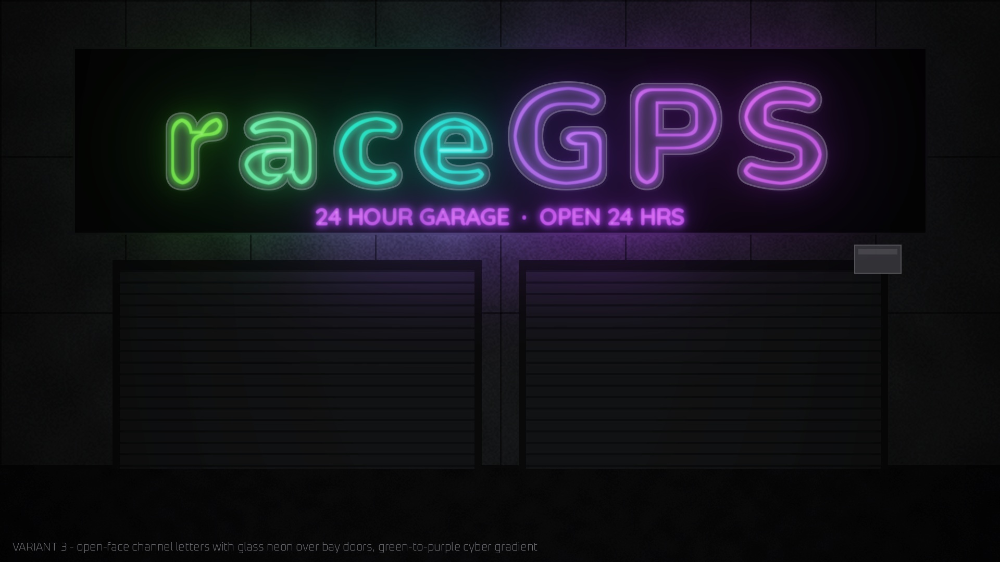 |

Flicker loops: [`art/garage-signs/*.mp4`](art/garage-signs/)

### Wordmark explorations
| | |
|---|---|
| 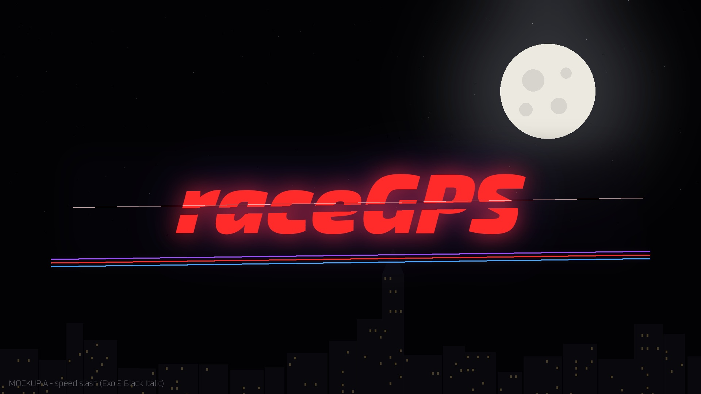 | 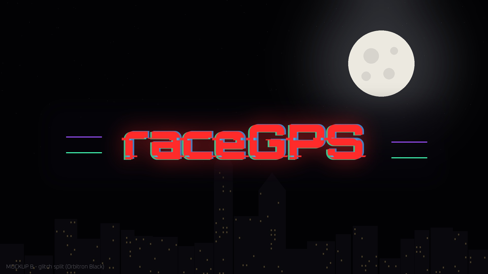 |
| 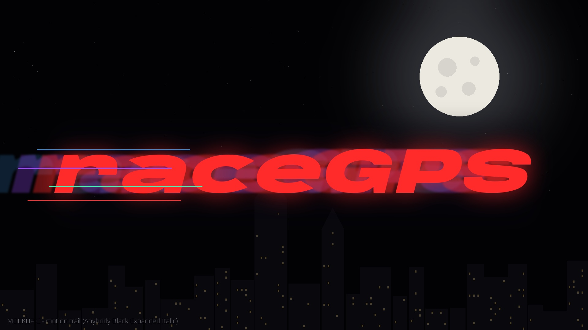 | 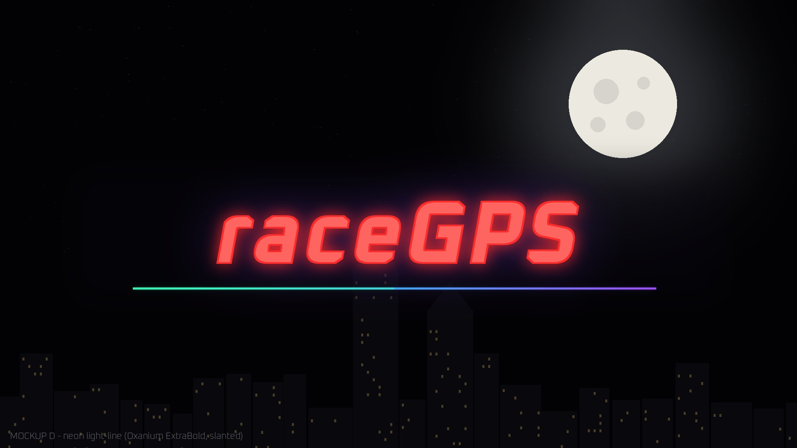 |

*A speed slash · B glitch split · C motion trail · D neon light-line. The moon-and-skyline backdrop is a simple stand-in, not the final plate. The current sign combines A and C.*

---

## Where it's going (concepts, not built yet)

- **ZIP-code intro routing.** Your ZIP code picks your intro. A Cleveland-area ZIP gets the Cleveland intro; a ZIP outside every covered area gets the intro of the nearest biggest covered city.
- **First to claim a ZIP.** The viral hook: be the first person to start up raceGPS in your ZIP code, and you get to create the first route there.

More in [`docs/FEATURE-IDEAS.md`](docs/FEATURE-IDEAS.md).

---

*Map data © OpenStreetMap contributors (ODbL). Fonts: SIL Open Font License (Google Fonts). Drive videos are linked, not included. Midnight Club is referenced only as an aesthetic description; raceGPS is not affiliated with it.*
